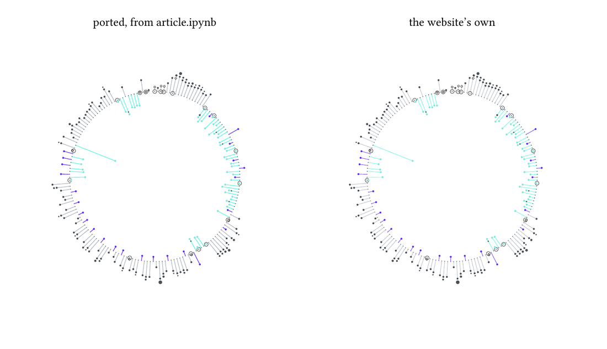

# Fingerprint drawing — a port of JDH's own code

`index.ts` draws an article's fingerprint from its `article.ipynb`, with no browser and
no network. It is a **port of the Journal of Digital History website's own code**, not an
independent design, and it has to keep matching that code to stay correct. This file
records where it came from and how to check it again.

If you change anything in `index.ts`, re-run the comparison in **Reproducing the check**
below. "It still looks like a fingerprint" is not a check.

## Why this exists at all

The original approach, and what this replaced, was to drive a headless Chromium to JDH's
live `/en/fingerprint-viewer`, intercept the viewer's notebook fetch with the local
`article.ipynb`, and read the rendered SVG back out of the page. That made every build
depend on a browser binary and on the JDH site being reachable and willing to serve a
headless client — and it was not: as of 25 Nov 2026, `journalofdigitalhistory.org` reset
the connection for Playwright's Chromium on every path, while `curl` got 200 and the same
Chromium reached other hosts fine. Suspected bot protection; confirmed with JDH that this
was not a local problem.

That route was removed along with the `playwright-core` dependency. It is in this
repository's history if it is ever wanted again — see the commit that deleted
`src/steps/shared/fingerprint.ts`. The one part of it still worth having is the snippet
for reading the site's own SVG back out of the page, which is how the check below works;
it is reproduced in **Reproducing the check**.

## Upstream source

Repository: **`C2DH/journal-of-digital-history`**, default branch **`develop`**.

Ported at `develop` = `c3aa3dafd834902a2b7e68f8a96fdd3ef856785c` (2026-11-24T15:49:12Z),
read on 2026-11-25.

| Upstream file | What came from it | Last upstream commit when ported |
| --- | --- | --- |
| `src/logic/parseNotebook.jsx` | `parseNotebook()` — per-cell character and cite2c counts, the heading/hermeneutics flags, and both extents | `7676fab3cee1716cf9fa04519e1294d15faa2fec` (2026-10-05) |
| `src/components/Article/ArticleFingerprint.jsx` | `drawFingerprint()` — the scales, the radii, the polar layout | `09ba0ff5f76b6e599b5915f3c84221af92f88deb` (2026-11-24) |
| `src/components/Article/ArticleFingerprintCellGraphics.jsx` | the per-cell line and circles | `328806ef7e009e13f3cc3987bdd83987a53f1aa6` (2026-06-17) |

Fetch any of them again with:

```bash
gh api repos/C2DH/journal-of-digital-history/contents/src/logic/parseNotebook.jsx --jq .content | base64 -d
```

### What was deliberately left out

- **`firstWords`.** `parseNotebook.jsx` renders each cell's markdown to build hover
  tooltip text. It feeds no geometry, and a PDF has no hover, so it is not ported. This is
  also the only thing upstream that needs a markdown parser — leaving it out is what keeps
  this module dependency-free.
- **The interactive layer.** The hover pointer line, the transparent hit-target `rect`,
  the react-spring animation and the `debug` guide circles. The site's SVG therefore has
  one more `<line>` than ours (its pointer, drawn with `stroke-opacity="0"`).
- **`extent` from `d3-array`.** Not needed; `parseNotebook` already accumulates both
  extents as it goes.

### Dependencies

**None, and it should stay that way.** The only thing borrowed from d3 is `scalePow`,
reimplemented inline in six lines: raise value and domain to the exponent, then
interpolate into the range. Upstream uses `scalePow().exponent(0.25)` for character counts
and `.exponent(1)` for reference counts. If you ever find yourself wanting `d3-scale`
here, port the six lines instead.

## The colours are not in the ported source

The site styles the fingerprint through CSS classes (`is-heading`, `is-hl`, `type-code`,
`type-markdown`, `.origin`, `.refs`, `.heading-placeholder`) defined in a **stylesheet**,
not in the three components above. The `INK` palette in `index.ts` was therefore read back
off a fingerprint the website had actually rendered, by taking each element's
`getComputedStyle` and mapping it to its classes.

**This is a silent coupling.** If JDH restyle the fingerprint, nothing here breaks or
warns — our colours simply stop matching the site. That is the most likely way this module
goes quietly wrong.

To re-derive the palette: render a fingerprint in a browser (see below), then for each
`<g>` read its `class` and each child's computed `stroke` and `fill`, and group by
(classes, tag, child class).

## Upstream is ahead of production

At the time of porting, `develop` carried `lineStrokeWidth = 1.2` (commit `09ba0ff5`,
*"fix(ArticleFingerprint): lineStrokeWidth increased to 1.2"*, 2026-11-24) — JDH's own fix
for the fingerprint rendering too faint, which Marion Salaün said in Slack was merged but
not yet deployed.

The **live site still rendered lines at 0.8** when this was checked, so:

- this module's output is intentionally **not** pixel-identical to the deployed site: our
  lines are thicker, which is the point;
- a comparison against the live viewer will show `stroke-width` 0.8 against our 1.2 while
  that remains true. Compare **geometry**, not stroke widths, until JDH deploy.

## Reproducing the check

The port was verified against the live viewer's own output for article `6ig87tC5GKjQ`
(178 cells): **every line and circle coordinate matched to 5e-7 px**, which is this
module's own 6-decimal rounding — 3e-14 px before rounding. 416 circles on both sides;
178 lines against the site's 179 (the extra one is its hover pointer).

1. **Get the notebook.**

```bash
curl -sL -o nb.ipynb https://raw.githubusercontent.com/jdh-observer/6ig87tC5GKjQ/main/article.ipynb
```

2. **Get the website's own SVG for the same notebook.** Open the viewer in a real browser —
   a headless one may be refused, see above — at:

   `https://journalofdigitalhistory.org/en/fingerprint-viewer?url=<url-encoded notebook URL>`

   then run this in the page to clone `svg.ArticleFingerprint` with the computed paint
   properties inlined, so it renders without the site's CSS:

```js
(() => {
  const svg = document.querySelector('svg.ArticleFingerprint');
  if (!svg) return null;
  const props = ['fill', 'stroke', 'stroke-width', 'opacity'];
  const style = (el) => {
    const computed = window.getComputedStyle(el);
    return props.map((p) => p + ':' + computed.getPropertyValue(p)).join(';');
  };
  const clone = svg.cloneNode(true);
  const originals = svg.querySelectorAll('*');
  const clones = clone.querySelectorAll('*');
  originals.forEach((el, i) => clones[i].setAttribute('style', style(el)));
  clone.setAttribute('style', style(svg));
  return clone.outerHTML;
})()
```

   Two gotchas. The markup contains `stroke="var(--secondary)"`, which resolves only
   against the site's stylesheet — Typst tolerates it but ImageMagick refuses the whole
   file, so strip it before rasterising. And the site draws one more `<line>` than we do:
   its hover pointer, marked `stroke-opacity="0"`.

3. **Draw the same notebook here**, at the size the page used (it is set by the page's
   layout — read `width` off the site's SVG; it was `615.984375`):

```ts
import { fingerprintFromNotebook } from './index.js';
const svg = fingerprintFromNotebook(await Bun.file('nb.ipynb').text(), { size: 615.984375 });
```

4. **Compare coordinates, not bytes.** The two differ in markup — ours is about half the
   size, with no classes and no interactive layer. Parse both, pull every `<line>`'s
   `x1,y1,x2,y2` and every `<circle>`'s `cx,cy,r` in document order, and diff numerically.
   Expect agreement to ~1e-6 px, and one extra line on the site's side.

A visual check is a useful backstop but not sufficient: place both SVGs side by side in a
Typst document and render at 200 dpi or more. At small sizes the strokes are faint enough
that real differences hide — a first attempt at 130 dpi looked blank for both.

## Things that have already caught someone out

- **The shortest cell sits exactly on the ring.** The character scale's range starts at 0,
  so the minimum-length cell has offset 0 and its line has zero length. A test fixture
  meaning to show a hermeneutics cell pointing *inward* has to give it something other than
  the shortest cell, or it lands on the ring and the assertion fails.
- **A long line reaching inward is real.** One cell in `6ig87tC5GKjQ` draws a long cyan
  line well inside the ring. It is a long hermeneutics cell, not an artifact — the website
  draws it too. It was misdiagnosed once as leftover interactive markup.
- **`hidden` beats `hermeneutics`.** Upstream stops reading tags once it sees `hidden`, so
  a cell tagged both is drawn but never as hermeneutics. Preserved here deliberately.
- **Headings are `markdown` cells only.** A `code` cell starting with `#` is a comment, not
  a heading.

## Status

Wired in: `generateSidebarImagesStep` calls `fingerprintFromNotebook()` here, drawing at
`size: 400`. That size is not cosmetic — see the comment on `FINGERPRINT_SIZE` in
`../../common/generate-sidebar-images.ts` for why a larger coordinate space makes the
strokes too fine to survive the sidebar.



Left: drawn here from `article.ipynb`. Right: the website's own, same article.
